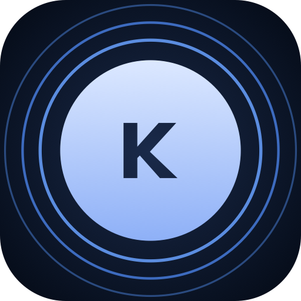

# KapKap

<p align="center">
  
</p>

<p align="center">
  <a href="https://github.com/unamatasanatarai/kapkap/releases/latest/download/KapKap.dmg">
    
  </a>
</p>

<p align="center">
  <strong>Record your Mac's screen in one click from the menu bar. Your recordings survive crashes.</strong>
</p>

<p align="center">
  
  
  
  
</p>

KapKap is a lightweight screen recorder that lives in your menu bar. Click the icon, pick the whole display or a region you drag out, turn on your microphone or system audio if you want them, and press Return. Click the icon again to stop: you get an MP4 in `~/Movies/KapKap/`, already selected in Finder.

It has no dock icon, no project files and no editor. You record, and you get a file.

---

## Why KapKap

Most screen recordings are quick: a bug repro, a walkthrough for a teammate, a clip of something on screen. KapKap keeps that to two clicks, and it is built so the recording is not lost when something goes wrong:

- **Crashes, force quits and power loss.** KapKap writes the video in fragments every 2 seconds, so the file on disk can be played while it is still being written. On the next launch, unfinished recordings are renamed `… (recovered).mp4` and shown in Finder.
- **Full disks.** A recording won't start with less than 1 GB free. If free space drops below 300 MB while you record, KapKap stops and saves the file.
- **Displays that disappear or capture failures.** If capture or writing fails partway, KapKap keeps what was recorded up to that point, shows the file in Finder and tells you what happened.
- **Quitting, logout or shutdown.** If you quit while recording, KapKap finishes writing the file before the app exits.

## What it does

### ⏺ One click to record
A left click on the menu bar icon opens the record bar, and a right click opens the menu (**Record Screen**, `⇧⌘R`). While you're recording, the icon changes to a stop button and any click on it stops the recording.

### ⬚ Fullscreen or a region
**Fullscreen** records the display your mouse is on. **Section** dims every screen so you can drag out a region. You can move it, resize it from eight handles, and see its exact output size in pixels as you go. The region is snapped to whole pixels, so the video matches what you selected.

### 🎙 Microphone and system audio in one track
Record your microphone, your Mac's sound (macOS 13+), or both. The sources are mixed into one AAC track (48 kHz stereo) and kept in sync with the video. If one source stalls, silence fills the gap and the other keeps recording.

### ✨ You can see what's being recorded
While a region records, an animated blue outline runs just outside it. The outline is never part of the video.

### 🎛 A record bar that stays out of the way
The record bar is a small icon-only panel at the bottom center of the active display. It remembers your last choices: area, microphone and system audio. Press **Return** to record and **Esc** to back out.

### 📼 Ready-to-share files
Recordings are H.264 MP4s named `Screen Recording YYYY-MM-DD at HH.MM.SS.mp4`. The bitrate scales with the resolution of the recorded area, so files stay a reasonable size even on Retina displays.

### 🛡 No accidental quits
Quitting takes two presses of `⌘Q`: the first shows *"Press ⌘Q again to quit KapKap"*.

## How it works

```text
1. Click the KapKap icon in the menu bar
2. Choose Fullscreen or Section (drag out a region), then toggle mic and/or system audio
3. Press Return or the record button
4. Click the menu bar icon to stop
5. The finished MP4 opens selected in Finder
```

On first use, macOS asks you to allow **Screen Recording** (and **Microphone**, if you turned it on). If a permission is missing, KapKap explains what to do and can open the right System Settings pane. A new Screen Recording grant needs a relaunch of the app.

## Under the hood

| | |
|---|---|
| **Capture** | ScreenCaptureKit on macOS 13+, with `CGDisplayStream` on macOS 12, where ScreenCaptureKit can start and then deliver no frames |
| **Encoding** | `AVAssetWriter`, H.264 High profile, fragmented MP4 with fragments every 2 seconds |
| **Audio** | A custom mixer that puts each source on a shared host-clock timeline before AAC encoding |
| **Region overlay** | Moved and resized with Core Animation layers instead of redrawing on every mouse event, so dragging stays smooth |
| **Dependencies** | None. Native Swift and AppKit, compiled with `swiftc` into a universal binary (x86_64 + arm64) |
| **Signing** | Hardened runtime on every build, with an optional self-signed certificate so permissions survive rebuilds |
| **Tests** | 100 unit tests covering the recording state machine, screen geometry, the audio mixer, file naming and crash recovery |

## Run it locally

**Requirements:** macOS 12.3 or later and the Xcode command line tools (`swiftc`, `xcrun`).

```bash
make run     # build build/KapKap.app and launch it
make test    # run the unit test suite
```

The app is unsigned by Apple, so Gatekeeper treats it as coming from an unidentified developer. The first time you open a packaged build, right-click it and choose **Open**.

### All commands

| Command | What it does |
|---|---|
| `make setup` | Set the app ID (bundle identifier) and name in `scripts/config.sh` |
| `make build` | Compile the `.app` bundle into `build/` and increment `BUILD_NUMBER` |
| `make run` | Stop any running instance, rebuild and launch |
| `make kill` | Stop running instances |
| `make test` | Run the native Swift test suite |
| `make signing-setup` | Create a self-signed code-signing certificate (once; no Apple account needed) |
| `make dmg` | Build a styled DMG in `build/KapKap-<version>.dmg` |
| `make release <x.y.z>` | Test, build the DMG, tag and publish a GitHub release with AI-generated release notes |
| `make revoke` | Reset the app's privacy permissions and clear the macOS icon and app caches |
| `make clean` | Remove build artifacts |

## Configuration

Settings live in [`scripts/config.sh`](scripts/config.sh):

```bash
export APP_NAME="KapKap"
export BUNDLE_ID="com.kapkap.app"
export MIN_MACOS_VERSION="12.3"
export LS_UI_ELEMENT="true"   # menu-bar only; set to false for a Dock icon
```

The app version always comes from the `VERSION` file. Every build increments `BUILD_NUMBER`.

## Signing and permissions

macOS ties Screen Recording and Microphone permissions to the app's code signature.

- **`make signing-setup`** creates a self-signed certificate in a separate keychain with its own password (`~/Library/Keychains/KapKap-signing.keychain-db`). Permissions then survive rebuilds, and no other binary can claim them without your key. The keychain is unlocked only while a build signs, then locked again.
- **Without the certificate**, builds are ad-hoc signed and tied only to the bundle ID. `make dmg` and `make release` refuse to package them unless `ALLOW_ADHOC_RELEASE=1` is set.
- **The hardened runtime** is on for every build, so no other program can inject code into KapKap and use its permissions.

After switching from ad-hoc signing to the certificate, run `make revoke` once and grant the permissions again. Back up the signing keychain and its password: a new certificate means everyone has to grant the permissions again.

## Releasing

```bash
export GEMINI_API_KEY="your-api-key"
make release 1.2.3
```

A release runs in three steps: **gather, ask, do**.

1. **Gather:** Checks the version and the git state and runs the tests. It collects every commit since the last tag and has Gemini write a release summary. Nothing is changed in this step.
2. **Ask:** Shows the full release log, the exact release notes and every action it will take. Nothing happens until you type `yes`.
3. **Do:** Updates `VERSION`, builds the DMG, commits, tags `vX.Y.Z`, pushes, and publishes the GitHub release with `gh`. If a step fails before the commit, `VERSION` is restored.

The version must be `X.Y.Z` and higher than both `VERSION` and the latest release tag, and the working tree must be clean.

## License

[GNU General Public License v2.0](LICENSE)
